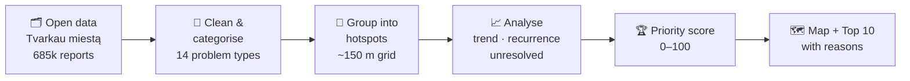

<div align="center">

# 📍 Vilnius Pulse

### A city problem radar for Vilnius: what to fix first, and why

*Turns 685,000+ resident reports into a ranked, explainable list of the city's most urgent problems.*


**Hack4Vilnius 2026 · Challenge 01 · Challenger: VILNIUS TECH**

</div>

---

## 🧩 The problem

> *"Information about urban problems – potholes, litter, parking, unsafe intersections, noise, public transport deficiencies – is scattered across different public sources and datasets. This makes it difficult to quickly spot recurring problems, assess their scale and determine which ones should be addressed first."*

Vilnius residents file **hundreds of reports every day** through *Tvarkau miestą*. Every report on its own is just one complaint. Together, they show exactly where the city is hurting, but nobody can read 685,000 reports.

## 💡 The solution

Vilnius Pulse reads the city's open data and answers three questions automatically:

| ❓ Question | ✅ How Vilnius Pulse answers it |
|---|---|
| **Where** are the problems? | Groups reports into ~150 m **hotspots** per problem type |
| **Which first?** | Ranks every hotspot with a transparent **priority score (0–100)** |
| **Why?** | Writes a **plain-language reason** for each one, like *"14 reports from 11 different residents in 90 days, up 3.5×, recurring for 9 months, 6 still unresolved"* |

## ⚙️ How it works



### The priority score

The formula is simple on purpose, so city officials can understand and trust it:

```
score = severity × residents × trend × recurrence × unresolved
```

| Factor | Meaning |
|---|---|
| 👥 **Different residents** | 10 people reporting the same pothole outweigh 1 person reporting it 50 times |
| 📈 **Trend** | Getting worse compared with the previous period |
| 🔁 **Recurrence** | Keeps coming back month after month |
| ⏳ **Unresolved** | Reports that are still open |
| ⚠️ **Severity** | Traffic safety weighs more than greenery (adjustable with sliders) |

Every hotspot also gets a tag: 🆕 **NEW** · 📈 **GROWING** · 🔁 **RECURRING** · ➖ **STABLE** · 📉 **FADING**

## ✨ Features

- 🗺️ **Interactive map** of hotspots, colored and sized by priority
- 🔥 **Top 10 "fix these first"** list with a reason for each
- 📊 **Trends over time** for every problem type
- ⚖️ **Adjustable weights**, so decision-makers can set their own priorities
- 🕰️ **Time travel**: analyse any date range in five years of data
- ⬇️ **CSV export** of all hotspots for city departments

## 🎯 Challenge requirements → features

| The challenge asks to… | Vilnius Pulse |
|---|---|
| analyse the city's **open data** | ✅ 685k+ *Tvarkau miestą* reports, 2021–2026 |
| automatically **identify** problems | ✅ 14 problem types |
| **group** them | ✅ location-based hotspots |
| **prioritize** them | ✅ transparent 0–100 score |
| find **where they recur** | ✅ recurrence tracking |
| show **how they change over time** | ✅ trends and NEW / GROWING / FADING tags |
| give **data-driven insights for decisions** | ✅ ranked list with reasons and CSV export |

## 🚀 Run it yourself

```bash
git clone https://github.com/JothamBanji/hack4vilnius.git
cd hack4vilnius
pip install -r requirements.txt
python -m streamlit run app.py
```

The cleaned dataset is included in `data/`. To rebuild it from the raw export, download
**„Tvarkau miestą" pranešimai** from [opendata.vilnius.lt](https://opendata.vilnius.lt), save it as
`tvarkau_miesta_reports.csv`, and run `python prepare.py`.

## 📁 Project structure

```
hack4vilnius/
├── app.py            # Streamlit website: map, Top 10, trends
├── analysis.py       # Hotspot detection + priority score
├── prepare.py        # Cleans the raw CSV into data/reports.parquet
├── data/
│   └── reports.parquet
└── requirements.txt
```

## 📚 Data sources

- [Vilnius City Open Data Portal](https://opendata.vilnius.lt/): *„Tvarkau miestą" pranešimai* (resident problem reports)
- [Department of Informatics and Communications map](https://maps.ird.lt/map/): traffic accidents *(in progress)*

---

<div align="center">

Built at **Hack4Vilnius 2026** by [Jotham Banji](https://github.com/JothamBanji)

</div>
